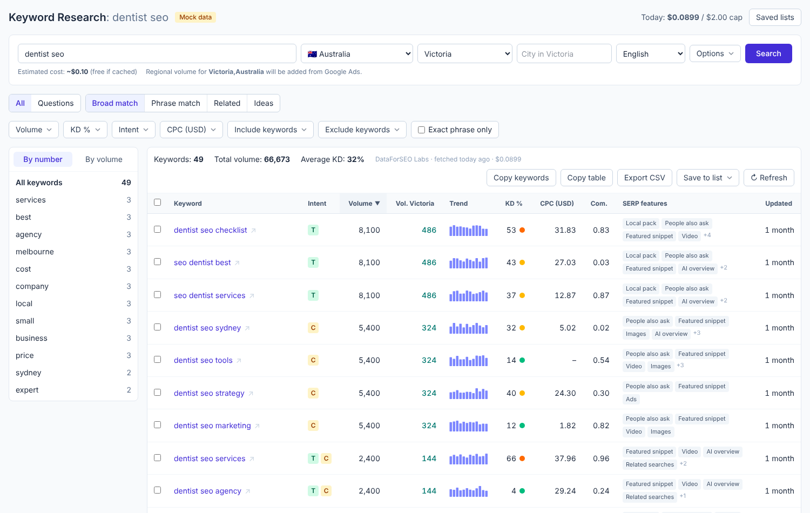

# Keyword Research micro app

A personal keyword research tool in the style of a "keyword magic" workflow, built on the
[DataForSEO](https://dataforseo.com/) API. Type a seed keyword, pick a country (and optionally a
state/region or city) and get keyword ideas with intent, volume, KD %, CPC, competition, a 12‑month
trend, SERP features and when the data was last updated. Filter, group, select, copy, export to CSV
and save lists.

- Backend: Python FastAPI + httpx + SQLite (cache, spend log, saved lists). Your DataForSEO
  credentials stay on the server.
- Frontend: React + TypeScript + Vite + Tailwind CSS + TanStack Table.


- See [docs/PLAN.md](docs/PLAN.md) for the design and which DataForSEO endpoints are used, and
  [docs/DEPLOY.md](docs/DEPLOY.md) for putting it on a VPS later.

## 1. Set up your credentials

```bash
cp .env.example .env
```

Open `.env` and paste your DataForSEO **API** login and password (from
https://app.dataforseo.com/api-access):

```
DATAFORSEO_LOGIN=you@example.com
DATAFORSEO_PASSWORD=your-api-password
DATAFORSEO_MOCK=false
DAILY_SPEND_CAP_USD=2.0
```

Want to click around first without spending anything? Set `DATAFORSEO_MOCK=true`. The app then
serves built‑in sample data for a handful of countries (a yellow "Mock data" badge shows in the header).

## 2a. Run locally with two terminals (best while developing)

Needs Python 3.11+ and Node 20+.

Terminal 1, the API:

```bash
cd backend
python3 -m venv .venv
source .venv/bin/activate          # Windows: .venv\Scripts\activate
pip install -r requirements.txt
uvicorn app.main:app --reload --port 8000
```

Terminal 2, the web app:

```bash
cd frontend
npm install
npm run dev
```

Open http://localhost:5173. Vite forwards `/api` calls to the backend on port 8000.

## 2b. Run locally with Docker (same setup you will use on the VPS)

```bash
docker compose up --build
```

Open http://localhost:8080. Data (cache, lists, spend log) is kept in `./data/app.db`.

## Using it

- **Country / State / City**: all countries DataForSEO supports. Keyword ideas, KD, intent and SERP
  features come from DataForSEO Labs, which is country level. If you pick a state or city, the app
  also asks Google Ads for that location's search volume and shows it in a separate teal
  **Vol. <region>** column. You can also pick a region after a search and click **Add volume for …**.
- **Tabs**: Broad match, Phrase match, Related, Ideas, plus All/Questions. "Exact phrase only" filters
  to keywords containing your seed words together and in order.
- **Filters**: Volume, KD %, Intent, CPC, include/exclude words, and the topic groups on the left.
- **Select rows** with the checkboxes (or the header box for all). Copy keywords, Copy table (tab
  separated, pastes straight into Excel / Google Sheets), Export CSV and Save to list work on the
  selected rows, or on everything that matches the filters when nothing is selected.
- **Cost**: the estimated cost shows under the search box before you search. Repeat searches within
  `CACHE_TTL_DAYS` come from the local cache and cost nothing. **Refresh** forces fresh data. Once
  today's spend would pass `DAILY_SPEND_CAP_USD`, the app refuses new API calls until tomorrow (UTC).
  Clickstream data is off unless you tick it in Options (it doubles the cost).
- **Updated**: DataForSEO's own last update date for Labs data. Google Ads data has no such date, so
  for those rows it shows when this app fetched it (hover the cell to see which).

## Tests

```bash
cd backend && pip install -r requirements-dev.txt && pytest     # uses mock data, no API calls
cd frontend && npm test
```

## Project layout

```
backend/   FastAPI app (app/), tests, Dockerfile
frontend/  React app (src/), Caddyfile(s), Dockerfile
docs/      PLAN.md, DEPLOY.md
docker-compose.yml        local / base
docker-compose.prod.yml   VPS overrides (HTTPS + basic auth)
```
